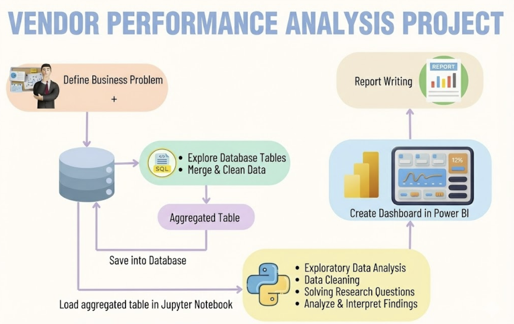

# Supply Chain & Vendor Performance Analysis

### *Finding where inventory capital is stuck across 126 vendors and 10,692 brands*

[](https://vendor-performance-analysis.streamlit.app/)


---

## Executive Summary

An end-to-end pipeline (raw CSVs → SQLite → Python → dashboard) that turns 2.4M purchase records and the matching sales and invoice data for a liquor and wine distributor into one row per vendor-brand. It answers three questions: how dependent the business is on a few vendors, where capital is tied up in slow-moving stock, and whether margins differ across brands.

**Headline result:** **$6.9M** of inventory, at cost, sits in **2,613 slow-moving brands** that sold less than 80% of what was bought during the period. Three vendors (Martignetti, Ultra Beverage and Perfecta Wines) account for **$2.9M** of it, so reviewing reorder quantities with them first targets the most capital.

**Live Dashboard:** [View on Streamlit Cloud](https://vendor-performance-analysis.streamlit.app/)

---

## Business Problem

The analysis sets out to:

- **Determine top vendors** by sales and gross profit, and how concentrated purchasing is.
- **Find capital tied up** in stock that isn't selling.
- **Check whether bulk purchasing** lowers unit costs.
- **Measure freight cost** by vendor.
- **Test whether margins differ** between top-selling and low-selling brands.

---

## Architecture & Project Flow

The project follows a standard data engineering lifecycle: **Ingestion → Storage → Processing → Visualization.**



### The Tech Stack

- **Ingestion:** Python (`pandas`, `os`) loads the raw CSVs (sales, purchases, purchase prices, vendor invoices, inventory).
- **Storage and transformation:** **SQLite** with SQL CTEs (`sqlalchemy`) builds the vendor-brand summary.
- **Analysis:** Python (`numpy`, `scipy`) for Pareto analysis, confidence intervals and Welch's t-test.
- **Visualization:**
  - **Streamlit:** public, interactive web app (deployed on Streamlit Cloud).
  - **Power BI:** stakeholder report with KPI cards and DAX measures.

---

## Key Insights & Findings

| Metric | Value | What it means |
| :--- | :--- | :--- |
| **Total Revenue** | **$451.62M** | All 10,514 brands with sales |
| **Gross Profit** | **$138.47M** | Revenue minus cost of the units actually sold |
| **Gross Margin** | **30.7%** | Revenue-weighted |
| **Freight Cost** | **$1.64M** | 0.51% of purchase cost; 0.36% of revenue |
| **Slow-Moving Stock** | **$6.94M** | Unsold units at cost in brands with turnover below 0.8 |

### Findings

1. **Vendor concentration:** the top 10 vendors supply **65.3%** of purchase dollars, and Diageo alone supplies 15.8%. A disruption at one of them would hit a large share of the range.
2. **Inventory build-up:** purchases outran sales by **$15.6M** at cost in the brands that bought more than they sold (**$8.7M** net once brands drawing stock down are included). The actionable part is the **$6.9M** in slow-moving brands, led by Martignetti ($1.21M), Ultra Beverage ($1.00M) and Perfecta Wines ($0.69M).
3. **Freight is not a lever:** every vendor's freight falls between **0.46% and 0.54%** of purchase cost, so it behaves like a flat charge and doesn't separate good vendors from bad ones.
4. **Margins barely differ by sales volume:** low-selling brands average **32.7%** and top-selling brands **31.6%**. Welch's t-test finds the gap significant (p < 0.001), but it is only 1.1 points (Cohen's d = 0.14), too small to justify different pricing strategies.
5. **No evidence of bulk discounts:** each brand has one purchase price in the data. High-volume brands are cheaper because they are cheaper products, not because they were bought in bulk.
6. **Low-sales, high-margin brands are immaterial:** 134 brands fit the "hidden gem" profile, but together they sold $21K. One margin point on the top 10 brands is worth about $570K.

---

## Data Quality: What Was Fixed

The first version of this project reported freight costs of **$543M**, more than total revenue. Tracing that number led to three errors in the pipeline, all now fixed in [`get_vendor_summary.py`](get_vendor_summary.py).

| Issue | Cause | Fix | Effect |
| :--- | :--- | :--- | :--- |
| **Freight counted hundreds of times** | Freight exists only at vendor-invoice level. The join copied each vendor's *total* freight onto every one of its brands, then the dashboard summed across brands. | Allocate each vendor's freight to its brands by share of purchase dollars. | $543.4M → **$1.64M** |
| **Gross profit treated unsold stock as a loss** | Gross profit was sales minus *total purchase dollars*, so any brand that bought more than it sold looked unprofitable. 1,949 brands were wrongly flagged as loss-making and filtered out. | Gross profit = sales − (units sold × unit cost). | 104 brands are truly sold below cost; margin is 30.7%, not 38.7% |
| **Capital-at-risk formula** | Total unsold units × the *average* purchase price across all brands. | Unsold units × each brand's own purchase price. | $18.63M → **$6.94M** in slow-moving brands |

Smaller fixes: the summary query now groups strictly by vendor and brand, so a brand whose name or price varies can't be split into rows that each pick up its full sales; vendors listed under two names (after a rename) are merged under one name; profit margin is left undefined instead of −∞ for brands with no sales; headline margins are revenue-weighted instead of an average of brand margins; the pipeline now writes `vendor_sales_summary.csv`, which the dashboard and notebook read.

**Limitation:** unsold stock is estimated as purchases minus sales during the period, which ignores opening inventory. The raw `end_inventory` table would give exact stock on hand.

---

## Dashboard

### Streamlit Web App
The interactive app lets supply chain managers filter by vendor, check stock turnover and drill into brands.

- **KPI row:** revenue, gross profit, gross margin, freight and slow-moving stock.
- **Treemap:** sales by vendor and brand, colored by margin.
- **Opportunity matrix:** sales vs. margin for each brand, tagged Standard, Slow-Moving, Below Cost, Never Sold or Hidden Gem.
- **Slow-moving stock by vendor:** the 10 vendors with the most capital tied up.
- **Turnover distribution** and a sortable detail table.

**Link:** [vendor-performance-analysis.streamlit.app](https://vendor-performance-analysis.streamlit.app/)

### Power BI
Stakeholder report built on the same summary table: `vendor_performance.pbix`.

---

## Repository Contents

| File | Purpose |
| :--- | :--- |
| `ingestion_db.py` | Loads every CSV in `data/` into `inventory.db` |
| `get_vendor_summary.py` | Builds and cleans the vendor-brand summary, writes it to the database and `vendor_sales_summary.csv` |
| `Exploratory Data Analysis.ipynb` | Exploration of the raw tables (needs `inventory.db`) |
| `Vendor Performance Analysis.ipynb` | Analysis and statistical tests (runs from the CSV) |
| `dashboard.py` | Streamlit app |
| `vendor_sales_summary.csv` | The summary table, one row per vendor-brand |
| `Vendor Performance Report.pdf` | Five-page written report of the findings |

---

## How to Run Locally

**1. Clone the repository**
```bash
git clone https://github.com/afeef-shaikh/Vendor-Performance-Analysis.git
cd Vendor-Performance-Analysis
```

**2. Install dependencies**
```bash
pip install -r requirements.txt
```

**3. Launch the Streamlit app** (uses the included `vendor_sales_summary.csv`)
```bash
streamlit run dashboard.py
```

**4. Rebuild the summary from raw data (optional)**

Put the raw CSVs (`purchases`, `purchase_prices`, `sales`, `vendor_invoice`, `begin_inventory`, `end_inventory`) in a `data/` folder; they are too large for the repository. Then run:
```bash
python ingestion_db.py
python get_vendor_summary.py
```

---

### *Author*
**Afeef Shaikh**
